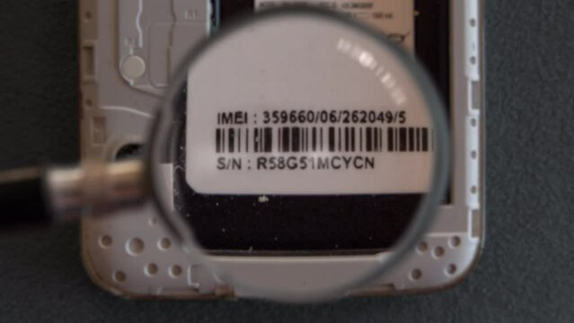
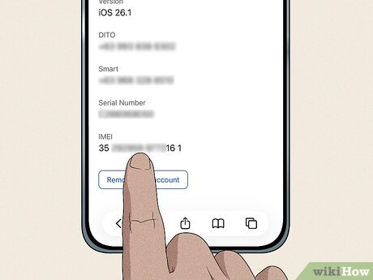
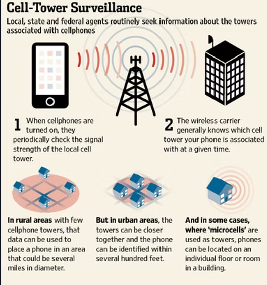
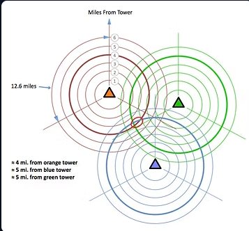

# How the government tracks your every move

## IEMI
- One of the ways that the government can track you is by using your phones IEMI(International Mobile Equipment Identity number).
- The IMEI is stamped on your phone

- Or you can find your IEMI inside settings

# How?
- Every time a cell phone attempts to connect to a cell tower, it pings the cell towers in the area to determine which is closest. Every cell phone or other device connecting to the cellular network (such as iPads) does this. 

- Every time a cellphone pings a tower, the phone’s IMSI, IMEI numbers as well as the the location of the cell tower is stored in the carrier’s database.

- By triangulating (multiple towers are used to track the phone’s location by measuring the time delay that a signal takes to return back to the towers from the phone) between the pings to the towers in the area, the location of the phone can be determined within 50-500 meters, depending upon the concentration of cell towers. 

- The closer the cell towers are together, such as in an big city, the more precise the data on the location of the phone. In urban areas, your location can be narrowed down to within 50 meters.

